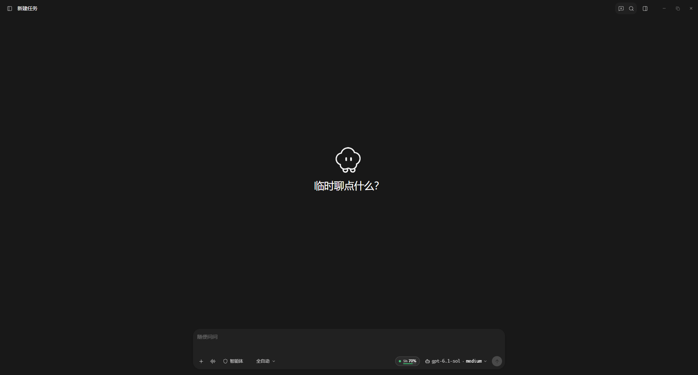
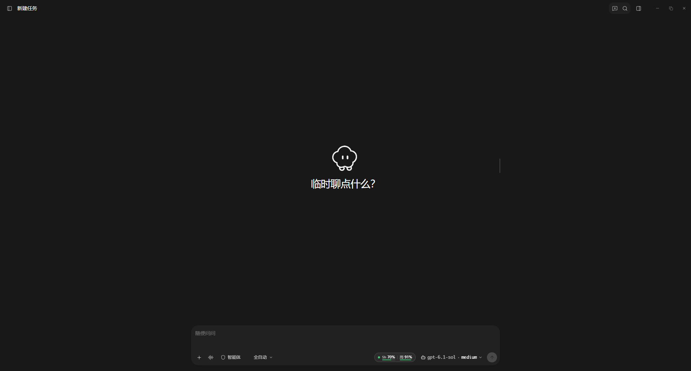
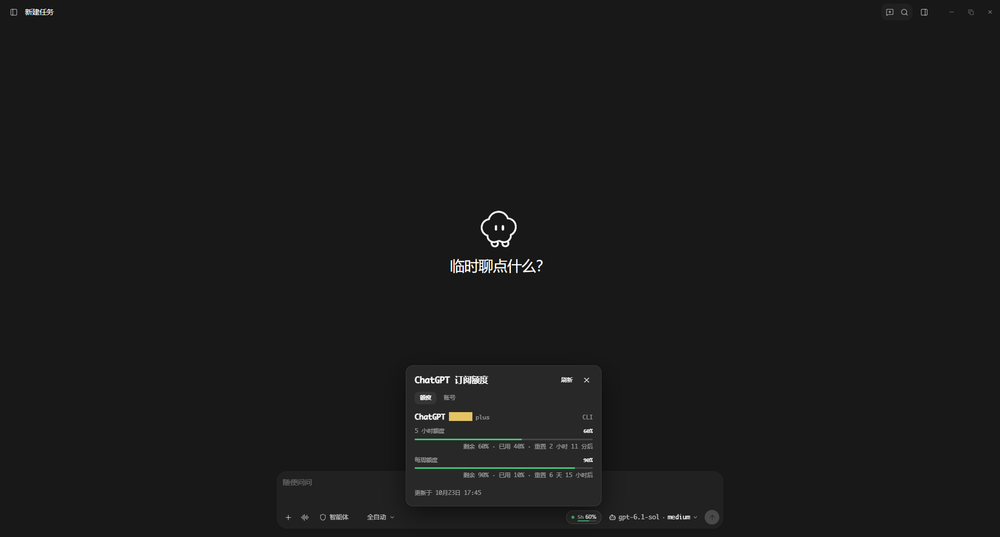
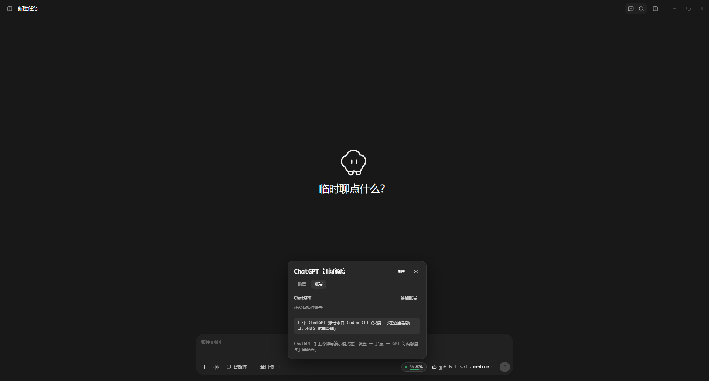
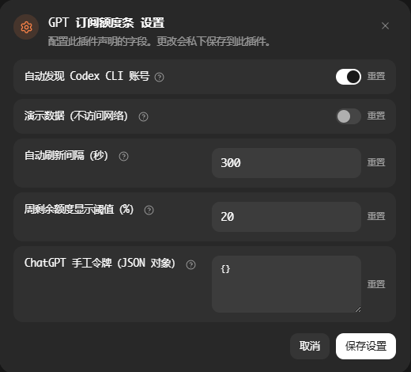

# GPT 订阅额度条 · GPT Subscription Quota Bar

**仅支持 ChatGPT 订阅额度。** 在 GPT 模型输入栏显示选定 ChatGPT 账号的 **5 小时 / 周** 剩余百分比与重置时间，点击打开额度详情和 ChatGPT 多账号管理。
没有工作面板视图，也没有独立面板窗口；不提供其他厂商登录、查询、自定义接口或手填额度。

> 本插件独立登录，不复用 PI-Desktop 的订阅登录，也不会自动切换宿主账号。
> 额度条显示的账号不保证是宿主当前会话登录的账号，使用多账号时请核对身份。

## 界面

```text
工具栏（仅 GPT 模型）： ● 5h 76% · 周 9%
                        └─ 点开 ──▶ ChatGPT 额度 / ChatGPT 账号管理
```

### 界面截图

以下为实际使用截图，非演示数据；账号名称已遮挡。额度与重置时间仅代表截图时的状态。
截图用于展示额度条与浮层布局，界面文案以实际运行版本为准。

**输入栏额度条**



**同时显示 5h 与周额度**

周剩余严格低于「周剩余额度显示阈值」时，会在 5h 旁追加周读数。
例如下图周剩余为 91%，将阈值设为 100% 即可同时显示 `5h 70% · 周 91%`。
阈值只控制显示，不限制实际用量；默认 10%，设为 0 可关闭周读数，等于阈值不追加。



**ChatGPT 额度详情**



**ChatGPT 账号管理**

仅提供 ChatGPT 独立登录入口；来自 Codex CLI 的账号为只读，不能在插件中管理。



**插件设置**

可配置 Codex CLI 发现、演示模式、刷新间隔、周额度显示阈值及 ChatGPT 手工令牌。
图中的周阈值 20% 为自定义设置，默认值仍为 10%；手工令牌字段为空。



### 显示行为

- 模型按钮名称含 `gpt` / `codex` / `chatgpt` 时显示；其他模型隐藏入口并关闭浮层。
- 默认显示 5 小时窗口；周额度低于阈值时追加周读数。缺少 5h 时回退到最短可用窗口。
- 圆点和进度条按剩余着色：>30% 绿、10–30% 橙、<10% 红；浮层保留接口返回的全部窗口。
- 显示账号身份、套餐、来源（插件 / 手工 / Codex CLI）、额度和重置倒计时，不向界面返回令牌。
- 加载中、首次失败或没有可读额度时仍保留灰色「ChatGPT 额度」入口，可进入账号页或重试。
- 额度条与浮层来自同一次读数；自动刷新、手动刷新、登录、删除和调整优先级后同步更新。
- 缓存过期后在后台请求，期间保留旧读数；并发查询合并，迟到的旧响应不覆盖新读数。

## 支持范围与账号选择

只使用 ChatGPT 订阅账号（内部 id：`openai-codex`）。
额度来自 `chatgpt.com/backend-api/wham/usage`，404 时回退到同域的 `/backend-api/codex/usage`。
不支持 OpenAI API 计费余额；登录成功也不保证账号拥有可读订阅额度。

多个 ChatGPT 插件账号分别查询、分别显示，不合并额度。账号优先级可上移 / 下移；
正常返回的所有窗口均剩余大于零、且无过期或异常读数时，才参与推荐，数字越小越优先。
耗尽、错误、空数据或未知状态不参与推荐；推荐不是模型级可用性保证。
额度条优先显示推荐账号，否则显示首个状态正常且有额度窗口的 ChatGPT 账号。
手工令牌和 CLI 账号不参与插件账号优先级推荐。

凭据来源规则：

1. 插件独立 OAuth 账号逐个显示，最多 10 个。
2. 设置中的 ChatGPT 手工令牌单独显示，不覆盖插件账号。
3. 仅在没有插件账号也没有手工令牌时，才使用开启的 Codex CLI 回退。

## 安装

需要 PI-Desktop **0.9.0 或更新版本**。

1. 从 [GitHub Releases](https://github.com/skir-zh/pi-desktop-gpt-quota-bar/releases/latest) 下载 `.piplug` 安装包，在插件页 → **安装插件包** 中选择该文件。
2. 审阅权限并授权（`renderer.extension` 与 `net.fetch` 属高风险）。
3. 切到名称含 GPT / Codex / ChatGPT 的模型，在输入栏右侧点击额度条。

开发时可用 **加载开发插件** 指向含 `manifest.json` 的根目录。源码保存后热重载，新增或放宽权限必须重新加载。

## ChatGPT 登录与管理

额度条 → **账号** → ChatGPT → **添加账号**，在系统浏览器完成独立 OAuth 授权。
不需要安装 CLI。若没有自动返回，把本次最终跳转的完整 `http://localhost:1455/auth/callback?…` 地址
（含 `code` 与 `state`）粘贴回浮层提交；不要分享该地址。

- 添加账号新增记录；重新授权只更新选中记录，取消或失败不删除旧账号。
- 同一时间只进行一个登录流程；浏览器可能沿用上次登录，请确认目标账号。
- 重复授权不代表获得额外额度；插件不因相同身份自动合并记录。
- 删除只移除选中的本地插件账号，不退出宿主或 Codex CLI，也不撤销服务商授权。
- 如需撤销授权，请到服务商账号安全页操作。
- Codex CLI 账号只读，不能在本插件中重新授权、排序或删除。
- 插件 OAuth 令牌临近过期时自动刷新；CLI / 手工令牌失效需在原来源更新。
- 非 GPT 模型下入口隐藏，管理账号前请切回 GPT 模型。

## 设置

设置 → 扩展 → **GPT 订阅额度条**：

| 键 | 类型 | 默认 | 说明 |
|---|---|---|---|
| `autoDetect` | boolean | `true` | 仅控制 Codex CLI 回退，只读 `~/.codex/auth.json` |
| `demoMode` | boolean | `false` | 仅显示 ChatGPT 示例，不读取 CLI、不访问网络，演示期间不能发起登录 |
| `refreshSeconds` | number | `300` | 缓存期限，范围 30–3600 秒；约每 20 秒检查一次，手动刷新不受期限限制 |
| `weeklyShowBelowPercent` | number | `10` | 周剩余严格低于阈值时追加周读数；0 关闭，范围 0–100，无效值按 10 处理 |
| `credentials` | json | `{}` | 仅识别 ChatGPT 的 `openai-codex` 令牌，属于普通宿主设置，不是 OAuth 加密文件 |

手工令牌支持 `{"openai-codex":"..."}` 或 `{"openai-codex":{"token":"...","accountId":"..."}}`。
仅支持 ChatGPT 授权令牌，不是 OpenAI API Key；请勿提交真实令牌到仓库。

为兼容部分宿主 JSON 表单，`credentials` 默认值为 JSON 文本；启动及设置保存后将对象规范化为文本。
内容不清空、不打印，运行时兼容对象和文本；仅识别 ChatGPT 的 `openai-codex` 条目。
演示模式、Codex CLI 开关或 ChatGPT 凭据变化会淘汰缓存和在途旧快照；纯显示阈值变化不额外查询上游。

## 权限与安全

| 权限 | 用途 |
|---|---|
| `renderer.extension` | 输入栏额度条与同窗口浮层 |
| `net.fetch` | 仅访问 `auth.openai.com` 与 `chatgpt.com` 的授权、刷新和额度端点 |
| `shell.openExternal` | 打开 ChatGPT 授权页面 |

- 不读取宿主密钥库，不读取其他厂商凭据，不自动切换宿主账号或转发聊天请求。
- OAuth 令牌通过 AES-256-GCM 保存在插件数据目录的 `quota-oauth.enc`；密钥 `quota-oauth.key` 在同目录。
  安全依赖系统文件权限，不是系统钥匙串，不能防御同用户权限恶意程序；不要分享这两个文件。
- 手工令牌由宿主作为普通插件设置保存，不属于以上密文存储。不要分享含令牌的设置或备份。
- Codex CLI 回退只读明确路径 `~/.codex/auth.json`，不遍历目录、不修改 CLI 文件。
- 授权期间 Node HTTP 仅监听 `127.0.0.1:1455`，检查路径、随机 state 和 PKCE；完成、取消、超时或卸载后关闭，最长 10 分钟。
- 界面只接收展示数据与本次授权所需的链接；令牌不写日志、不进入额度快照、不返回界面。
- renderer 与宿主共享文档，不是隔离沙箱；Node 插件进程也不是操作系统级能力沙箱，只应安装可信代码。
- 不注册常驻服务、不注入 Agent 提示词、不发系统通知。

安全报告见 [SECURITY.md](SECURITY.md)。

## 已知限制

- ChatGPT 额度接口是私有接口，服务端变更可能需要适配；异常读数不当作剩余 100%。
- 模型判断观察当前输入栏 DOM 的 `.composer-right` / `.composer-model-thinking-model`，不是稳定的 SDK 模型元数据接口。
  自定义别名不含 `gpt` / `codex` / `chatgpt` 时入口隐藏；只观察输入栏，不读取聊天内容。
- 显示的是插件、手工令牌或 Codex CLI 中的 ChatGPT 账号，不能严格关联到宿主当前登录账号。
- 自动化测试使用模拟授权和本机回调，不替代 PI-Desktop 宿主集成与真实账号授权验收。

## 开发、校验与发布

直接运行 JavaScript，无编译步骤；开发依赖不参与插件运行。

```bash
npm ci
npm test
node --check main.js
node --check renderer/index.mjs
npx playwright install chromium
npm run test:browser
# Windows 已安装 Edge 时可用（Git Bash）：
PI_BROWSER_CHANNEL=msedge npm run test:browser
```

测试使用真实 renderer、React 和本地模拟响应，不访问真实账号，覆盖 ChatGPT 专用边界、读数同步、缓存、授权和布局竞态。
实测步骤见 [TESTING.md](TESTING.md)。使用 PI-Desktop 的 `PluginCheck` 校验，`PluginPack` 生成 `dist/<id>-<version>.piplug`。
`.piplug` 必须是 store-only ZIP，不要使用普通压缩工具重打。

## 目录结构

```text
manifest.json          插件身份、设置、权限与两个联网域名
main.js                ChatGPT 查询、Codex CLI 发现、快照与通道路由
renderer/              额度条与自绘浮层、模型观察及读数同步
lib/oauth.js           ChatGPT 授权、账号管理与令牌刷新
lib/auth-store.js      OAuth 凭据密文存储
lib/recommendations.js  ChatGPT 插件账号推荐
lib/settings-json.js   宿主 JSON 设置兼容
tests/                 无真实凭据的单元与浏览器回归
screenshots/           脱敏界面截图
package*.json          仅供开发测试的依赖与锁文件
TESTING.md             宿主实测清单
SECURITY.md             安全说明
LICENSE                MIT
```

## 许可

[MIT](LICENSE)。第三方依赖保留各自许可证；后续引入第三方代码时，需保留必要版权与许可声明。
